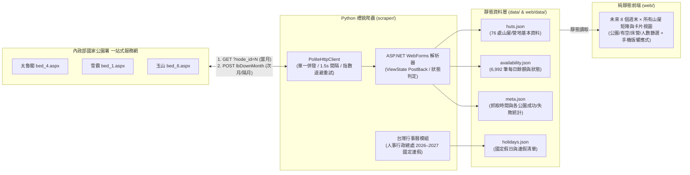
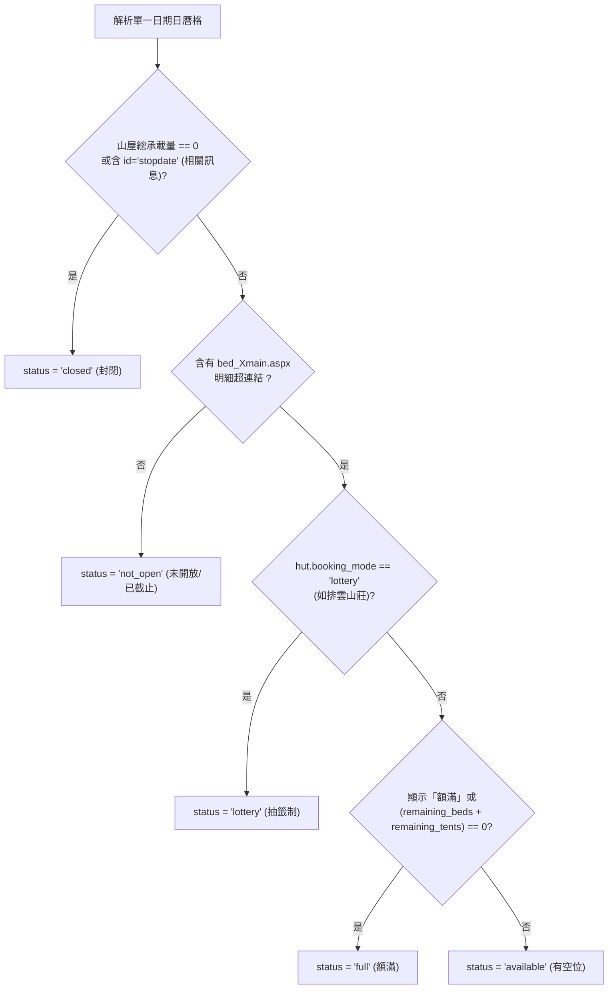

# 系統架構設計 (`architecture.md`)

## 一、整體架構概覽

本專案採用 **「離線禮貌爬蟲產出靜態 JSON ＋ 純靜態前端矩陣渲染」** 的無伺服器（Serverless Static）架構：
1. **不在瀏覽器端直接對官方網站發送任何請求**：避免 CORS 問題，更避免大量山友同時開啟網頁時對官方伺服器造成負擔。
2. **定時單一併發禮貌更新**：由本機 `run_scrape` 或 GitHub Actions 每 30 分鐘以單一併發、每次請求間隔 1.5 秒以上之禮貌速率更新 `data/*.json`，並自動部署至 Firebase Hosting（https://taiwan-hut-availability.web.app）。



---

## 二、爬蟲與 ASP.NET WebForms PostBack 狀態機 (`scraper/src/`)

### 1. 模組分工
- `scraper/src/models.py`：定義嚴格的資料結構 `Capacity`、`Hut`、`Availability`。
- `scraper/src/parser.py`：
  - `parse_main_page(park, html)`：解析各公園總表頁（`bed_4.aspx`、`bed_1.aspx`、`bed_6.aspx`），提取 `node_id`、名稱、平日／假日床位與營位承載量，並自動判定 `kind`（`hut` | `camp` | `both`）與 `booking_mode`（`first_come` | `lottery`）。
  - `extract_postback_fields(html)`：提取 `<form id="form1">` 中所有隱藏欄位（`__VIEWSTATE`、`__VIEWSTATEGENERATOR`、`__EVENTVALIDATION`、`ctl00$con$hidYear`、`ctl00$con$hidMonth` 等）與下拉選單當前值。
  - `parse_calendar_page(hut, html)`：依據當月第一天星期幾計算 7 欄月曆格索引（`idx = first_col + day - 1`），精準解析當月每一天的餘額、排隊預約／候補、審核中／待處理、已通過／核准入園及狀態。
- `scraper/src/scraper.py`：
  - `PoliteHttpClient`：封裝 `httpx.Client`，強制執行單一併發、請求間隔 `>= 1.5s`、明確的專案 `User-Agent`，以及失敗時指數退避重試 3 次（`1.5s -> 3.0s -> 6.0s`）。
  - `scrape_hut_availability`：對單一山屋依序執行 `GET ?node_id=N`（當月）→ `POST ctl00$con$lbDownMonth`（+1 月）→ `POST ctl00$con$lbDownMonth`（+2 月）。單一山屋若發生例外錯誤，由外層捕捉並記錄至 `meta.json` 的 `failed_huts`，不中斷其他山屋或公園。
- `scraper/src/holidays.py`：內建行政院人事行政總處 2026–2027 年政府行政機關辦公日曆表（含國定假日與連假），並提供週末／國定連假住宿夜區塊計算邏輯。

### 2. 狀態判定邏輯 (`status`)



---

## 三、資料模型規格 (`data/*.json`)

### 1. `data/huts.json`
```json
{
  "id": "yushan_4",
  "park": "yushan",
  "node_id": "4",
  "name": "圓峰山屋/營地",
  "kind": "both",
  "capacity": {
    "weekday_beds": 15,
    "weekday_tents": 9,
    "holiday_beds": 15,
    "holiday_tents": 9
  },
  "booking_mode": "first_come",
  "source_url": "https://hike.taiwan.gov.tw/bed_6.aspx?node_id=4"
}
```

### 2. `data/availability.json`
```json
{
  "hut_id": "yushan_4",
  "date": "2026-12-04",
  "remaining_beds": 0,
  "remaining_tents": 1,
  "queue": 5,
  "reviewing": 0,
  "approved": 23,
  "status": "available"
}
```

### 3. `data/meta.json`
記錄 `fetched_at`（ISO 8601 時間戳）、`total_huts`、`success_count`、`failed_count`、`failed_huts` 以及各公園（`taroko`、`sheipa`、`yushan`）之支援狀態與成功／失敗統計。

---

## 四、前端週末與國定連假住宿夜演算法 (`web/app.js`)

山友規劃週末或連假登山時，實際需要申請的是**「休假日前一晚（D0/第一晚）至休假結束前一晚」的住宿夜**：
- 對任意連續休假日區間 $[D_{\text{start}}, D_{\text{end}}]$（包含週六、週日及人事行政總處公告之國定假日／補假，且連續休假天數 $\ge 2$）：
  - **住宿夜集合** = $\{ D_{\text{start}} - 1\text{ 天} \} \cup \{ d \mid D_{\text{start}} \le d \le D_{\text{end}} - 1\text{ 天} \}$
- **範例驗證**：
  - **一般週末**（週六、週日休假）：住宿夜為 **週五夜、週六夜**。
  - **週五放假之 3 天連假**（如 `2026-12-25 行憲紀念日` 或 `2027-01-01 元旦`，週五～週日休假）：住宿夜自動涵蓋 **週四夜（連假前夜）、週五夜、週六夜**。
  - **週一放假之 3 天連假**（週六～週一休假）：住宿夜自動涵蓋 **週五夜、週六夜、週日夜**。
